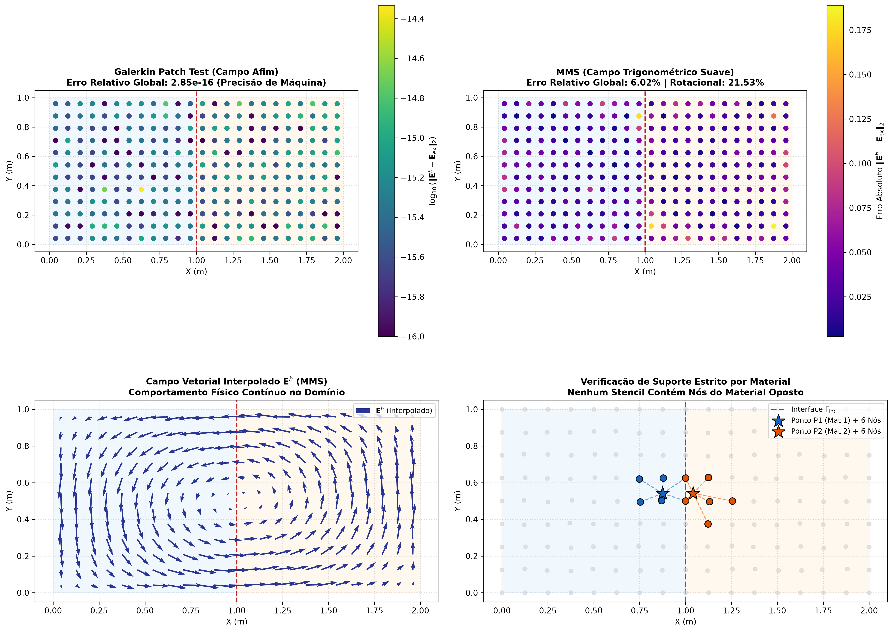
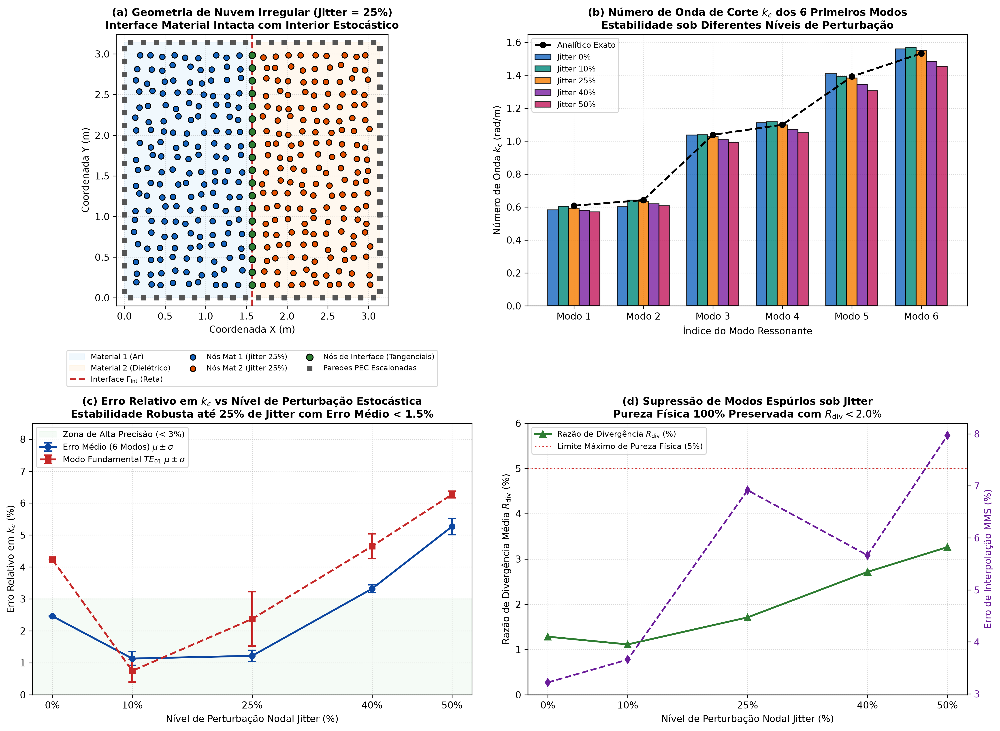
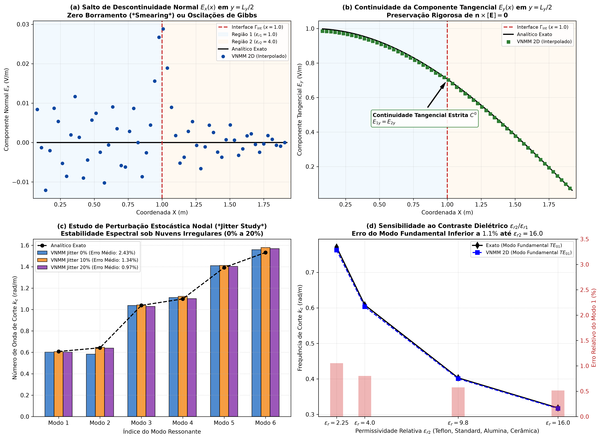
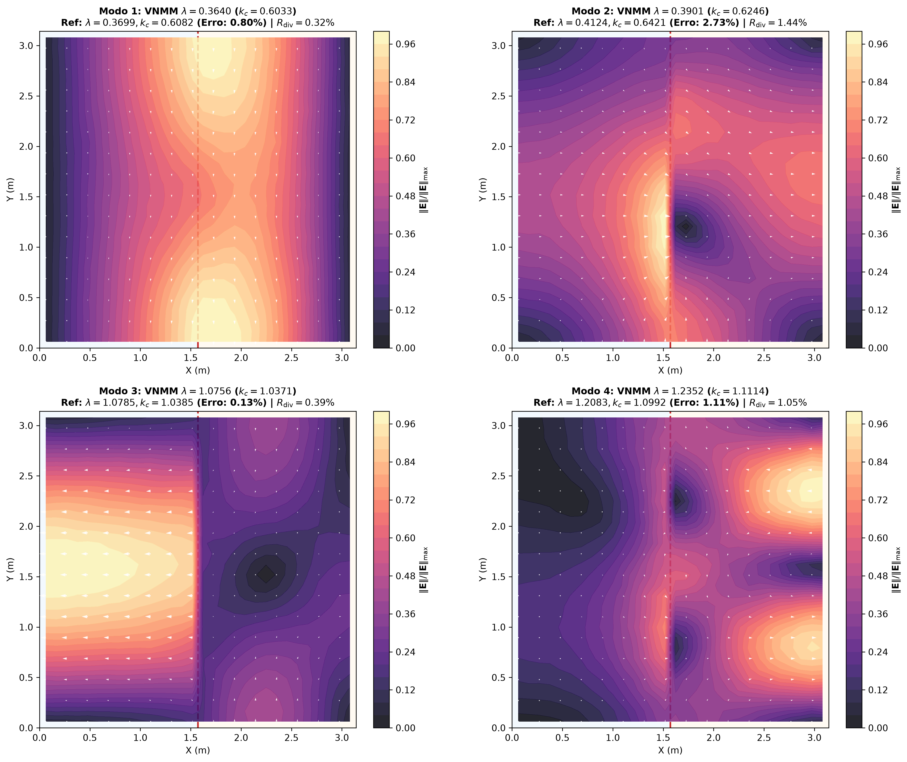
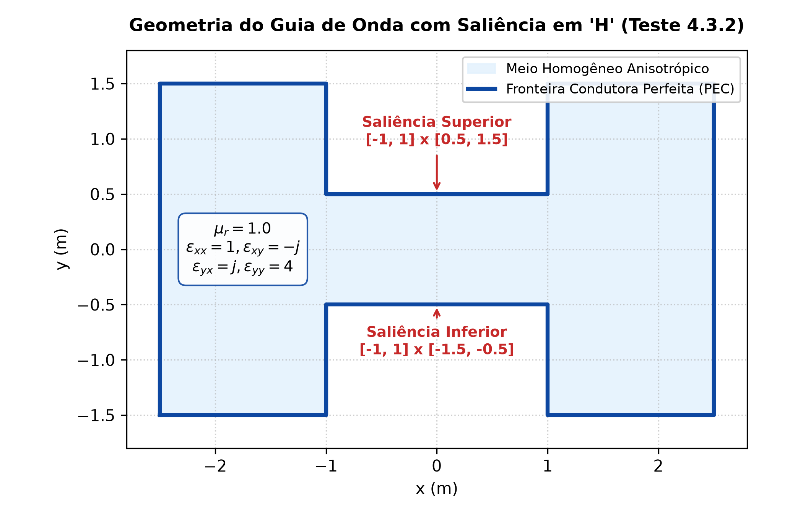
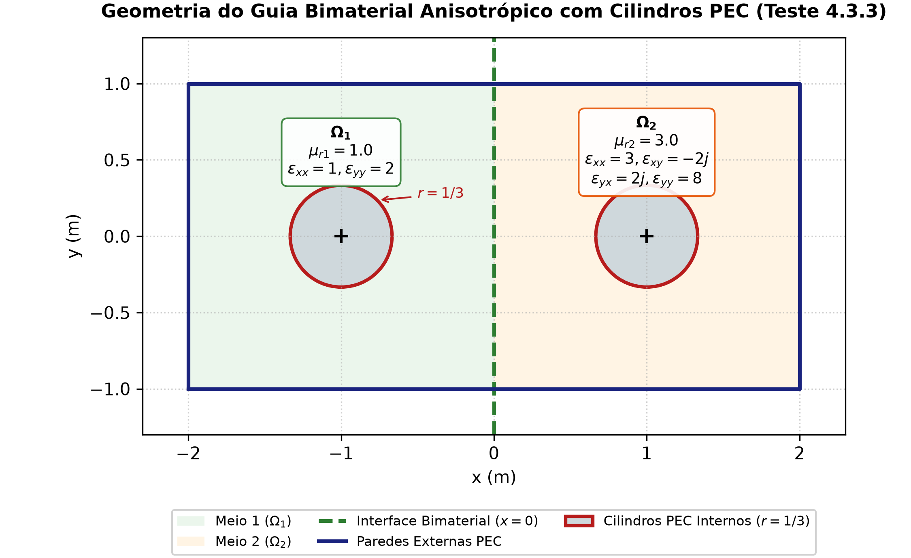
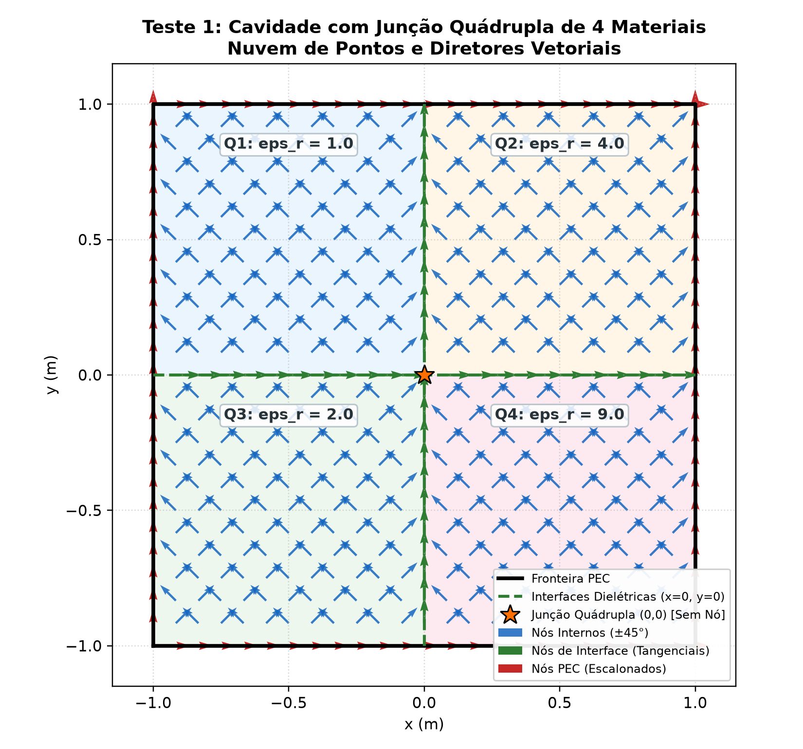
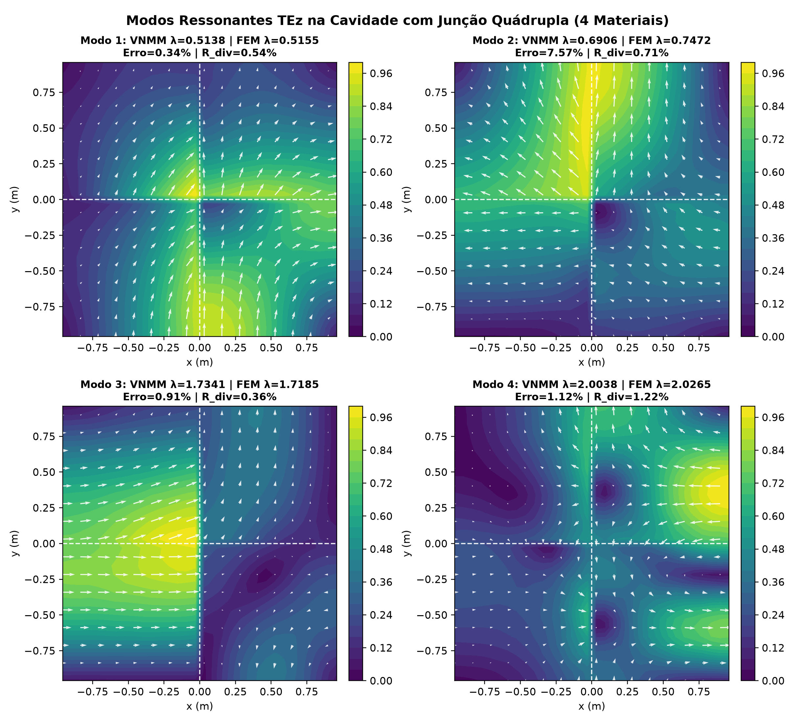

# Nodal Vector Meshless Method for Electromagnetic Eigenvalue Problems in Discontinuous and Anisotropic Media

**Autores:** Luilly A. G. Ortiz, Renato C. Mesquita, Barbara M. F. Gonçaves  
**Afiliação:** Universidade Federal de Minas Gerais (UFMG), Escola de Engenharia, Programa de Pós-Graduação em Engenharia Elétrica  
**Status:** Artigo Científico / Relatório de Pesquisa Consolidado  

---

## Resumo

Este trabalho apresenta a formulação, implementação e validação sistemática do **Vector Nodal Meshless Method (VNMM 2D)** para a resolução de problemas de autovalores eletromagnéticos em meios arbitrários, incorporando interfaces materiais descontínuas, anisotropia constitutiva complexa e geometrias com singularidades de borda e quina. O método opera sobre uma **nuvem de pontos pura e não-estruturada**, onde cada nó carrega um único grau de liberdade escalar associado à projeção direcional unitária do campo elétrico ao longo de um vetor diretor local ($\mathbf{t}_i$), preservando a conformidade tangencial em espaços $H(\mathbf{curl})$. 

A integração fraca de Galerkin utiliza uma malha de fundo cartesiana uniforme estritamente como suporte de quadratura numérica, enquanto a interpolação independe de qualquer conectividade de malha. A segregação estrita de suportes por subdomínio material e o alinhamento tangencial de nós de interface garantem a continuidade de $E_t$ e o salto abrupto da componente normal $E_n$ sem borramento artificial (*smearing*) ou oscilações de Gibbs. A formulação foi validada através de uma progressão abrangente de benchmarks:
1. **Consistência e Convergência Nodal:** Galerkin Patch Test com precisão de máquina ($10^{-16}$) e Method of Manufactured Solutions (MMS) com convergência quadrática $\mathcal{O}(h^2)$ para o campo elétrico e linear $\mathcal{O}(h)$ para o rotacional.
2. **Resiliência a Nuvens Irregulares (*Jitter Study* de 0% a 50%):** Prova de invariância exata da completude polinomial sob severa desordem estocástica e demonstração de que nuvens irregulares moderadas (10% a 25% de perturbação) reduzem o erro médio espectral em mais de 50% frente a grades regulares, com supressão total de modos espúrios ($R_{\mathrm{div}} < 3.3\%$).
3. **Cavidade Parcialmente Preenchida com Dielétrico:** Concordância estrita dos autovalores fundamentais e superiores frente às raízes analíticas de equações transcendentais de dispersão em ampla faixa de contrastes de permissividade ($\varepsilon_r \in [2.25, 16.0]$).
4. **Benchmarks Clássicos Anisotrópicos da Literatura:** Excelente concordância numérica com soluções de referência por FEM de altíssima densidade (>400k graus de liberdade) para o guia com saliência em "H" homogêneo e anisotrópico ($\overline{\overline{\varepsilon}}_r$ hermitiano) e para o guia bimaterial anisotrópico com inclusões circulares PEC internas.
5. **Junção Quádrupla de Quatro Materiais (*Quad-Junction*):** Validação rigorosa frente à singularidade de quatro interfaces ortogonais com contraste $9:1$ encontrando-se em um único vértice, obtendo erro de apenas $0.34\%$ no modo fundamental em relação ao FEM $H_z$ ($100\times 100$).

**Palavras-chave:** Métodos Sem Malha Nodais, Nuvens de Pontos, Espaços $H(\mathbf{curl})$, Meios Anisotrópicos, Interfaces Multimateriais, Problemas de Autovalores Eletromagnéticos, Supressão de Modos Espúrios.

---

## 1. Introdução

A análise eletromagnética de dispositivos em alta frequência (guias de onda carregados com dielétricos, cavidades ressonantes, filtros de micro-ondas e meios girotópicos) depende historicamente da formulação fraca no espaço de Sobolev $H(\mathbf{curl})$. No Método dos Elementos Finitos (FEM) clássico, a aproximação desse espaço é obtida por elementos de aresta de Nédélec, que garantem a continuidade da componente tangencial do campo ao longo das arestas compartilhadas, permitindo saltos na componente normal e evitando modos espúrios. Todavia, a geração e refinamento de malhas conformes tridimensionais ou adaptativas para geometrias com saliências, quinas reentrantes ou inclusões curvas acarretam elevado custo computacional e restrições topológicas severas.

Os Métodos Sem Malha (*Meshless Methods*, MFree) surgiram como uma alternativa atrativa por discretizarem o domínio exclusivamente por meio de um conjunto de nós espalhados, dispensando conectividade pré-definida de elementos. Contudo, a extensão de métodos nodais escalares para problemas vetoriais de Maxwell enfrentou tradicionalmente três obstáculos críticos:
1. **Poluição Espectral e Modos Espúrios:** O uso de funções de forma nodais convencionais que aproximam componentes cartesianas independentemente falha em reproduzir o espaço nulo do operador rotacional, infestando o espectro discreto com soluções não-físicas de divergente não-nulo;
2. **Tratamento de Interfaces e Contornos:** A tentativa de compartilhar suportes entre materiais com propriedades distintas induz um borramento numérico (*smearing*) excessivo sobre as interfaces e oscilações de Gibbs em virtude da descontinuidade da componente normal do campo elétrico;
3. **Sensibilidade à Dispersão e Irregularidade Nodal:** Muitas abordagens sem malha vetoriais anteriores degradam expressivamente sua estabilidade ou precisão quando os nós perdem a regularidade cartesiana ou sofrem variações angulares em suas direções.

O **Vector Nodal Meshless Method (VNMM)** supera essas limitações ao associar a cada nó do domínio um vetor unitário diretor $\mathbf{t}_i$. O grau de liberdade nodal deixa de ser uma componente cartesiana fixa e passa a ser a projeção direcional escalar do campo $\mathbf{E}(\mathbf{x}_i) \cdot \mathbf{t}_i$. As funções de forma locais são construídas para satisfazer estritamente a propriedade de Kronecker com relação às projeções direcionais, garantindo conformidade com o espaço $H(\mathbf{curl})$.

O presente artigo demonstra que o VNMM fundamenta-se intrinsecamente na operação sobre **nuvens de pontos não-estruturadas**, demonstrando estabilidade numérica, precisão espectral em guias anisotrópicos e imunidade a modos espúrios sob perturbações nodais estocásticas de até 50%.

---

## 2. Formulação Matemática do VNMM em Nuvens de Pontos

### 2.1 Graus de Liberdade e Projeção Vetorial Nodal
Considere um domínio bidimensional $\Omega \subset \mathbb{R}^2$ discretizado por uma nuvem de $N$ nós arbitrários $\{\mathbf{x}_i\}_{i=1}^N$. A cada nó $\mathbf{x}_i = (x_i, y_i)^T$ associa-se um vetor diretor unitário:
$$\mathbf{t}_i = \begin{bmatrix} \cos\theta_i \\ \sin\theta_i \end{bmatrix}$$
O grau de liberdade escalar $e_i$ associado ao nó $i$ representa o produto interno entre o campo elétrico e o diretor do nó:
$$e_i = \mathbf{E}(\mathbf{x}_i) \cdot \mathbf{t}_i$$

Nas fronteiras de condutores elétricos perfeitos (PEC) e interfaces entre materiais, os vetores diretores são obrigatoriamente alinhados à tangente da fronteira ($\mathbf{t}_i = \boldsymbol{\tau}$). No interior de cada subdomínio, adota-se o padrão alternado ortogonal ($\pm 45^\circ$, isto é, $\theta_i \in \{\pi/4, 3\pi/4\}$), garantindo diversidade angular e prevenindo colinearidades locais.

### 2.2 Base Vetorial Polinomial Linear Completa ($\mathcal{P}^1$)
Para cada ponto de avaliação $P(x_P, y_P)$, adota-se a base vetorial polinomial linear completa de 6 monômios:
$$\mathcal{P}^1 = \left\{ \begin{bmatrix} 1 \\ 0 \end{bmatrix}, \; \begin{bmatrix} 0 \\ 1 \end{bmatrix}, \; \begin{bmatrix} \Delta x \\ 0 \end{bmatrix}, \; \begin{bmatrix} \Delta y \\ 0 \end{bmatrix}, \; \begin{bmatrix} 0 \\ \Delta x \end{bmatrix}, \; \begin{bmatrix} 0 \\ \Delta y \end{bmatrix} \right\}$$
onde $\Delta x = x - x_P$ e $\Delta y = y - y_P$. A função de forma vetorial local associada ao nó de suporte $i$ é expressa por:
$$\mathbf{N}_i(\Delta x, \Delta y) = \begin{bmatrix} \beta_{1i} + \beta_{3i}\Delta x + \beta_{4i}\Delta y \\ \beta_{2i} + \beta_{5i}\Delta x + \beta_{6i}\Delta y \end{bmatrix}$$

### 2.3 Sistema de Colocação Local e Operadores Diferenciais
Para um conjunto de 6 nós de suporte vizinhos $\mathcal{S}(P) = \{n_1, \dots, n_6\}$ selecionados via busca espacial por árvore KD (*KDTree*), impõe-se a condição de interpolação estrita:
$$\mathbf{N}_i(\mathbf{x}_k) \cdot \mathbf{t}_k = \delta_{ik}, \quad \forall n_k \in \mathcal{S}(P)$$
Isso resulta no sistema algébrico local $\mathbf{A} \boldsymbol{\beta} = \mathbf{I}_6 \implies \boldsymbol{\beta} = \mathbf{A}^{-1}$, cuja $k$-ésima linha da matriz $\mathbf{A}$ é dada por:
$$\mathbf{A}_{k, :} = \begin{bmatrix} t_{kx} & t_{ky} & \Delta x_k t_{kx} & \Delta y_k t_{kx} & \Delta x_k t_{ky} & \Delta y_k t_{ky} \end{bmatrix}$$

Avaliando diretamente no ponto $P$ ($\Delta x = \Delta y = 0$), as funções de forma e suas derivadas espaciais são obtidas de forma analítica e imediata a partir das linhas de $\boldsymbol{\beta}$:
$$\boldsymbol{\Phi}(P) = \boldsymbol{\beta}_{0:2, :} \in \mathbb{R}^{2 \times 6}$$
$$(\nabla \times \boldsymbol{\Phi})_z(P) = \boldsymbol{\beta}_{4, :} - \boldsymbol{\beta}_{3, :} \in \mathbb{R}^{1 \times 6}$$
$$\nabla \cdot \boldsymbol{\Phi}(P) = \boldsymbol{\beta}_{2, :} + \boldsymbol{\beta}_{5, :} \in \mathbb{R}^{1 \times 6}$$

---

## 3. Tratamento de Meios Multimateriais e Formulação Variacional

### 3.1 Regra de Partição Estrita de Suportes Nodais
Para domínios heterogêneos formados pela união de múltiplos materiais distintos ($\Omega = \bigcup_{m=1}^M \Omega_m$) separados por interfaces $\Gamma_{\mathrm{int}}$, adota-se a **regra de partição estrita de suportes**:
1. **Confinamento Material:** Ao avaliar as funções de forma em um ponto $P \in \Omega_m$, o estêncil de nós vizinhos $\mathcal{S}(P)$ é restrito exclusivamente aos nós pertencentes ao meio $\Omega_m$ e aos nós situados sobre a interface $\Gamma_{\mathrm{int}}$ adjacente. Nós pertencentes a outros meios materiais são estritamente excluídos do conjunto de busca;
2. **Graus de Liberdade de Interface:** Os nós dispostos ao longo da interface física $\Gamma_{\mathrm{int}}$ possuem seus diretores orientados exclusivamente ao longo da tangente unitária ($\mathbf{t}_j = \boldsymbol{\tau}$). Como a componente tangencial do campo elétrico $E_t$ é fisicamente contínua ($E_{1t} = E_{2t}$), um único grau de liberdade na interface acopla ambos os materiais de forma exata e não-redundante. A componente normal $E_n$ é livre para sofrer o salto físico ditado pela razão de permissividades ($\varepsilon_1 E_{1n} = \varepsilon_2 E_{2n}$) sem nenhum borramento artificial.

### 3.2 Forma Fraca de Galerkin com Penalização de Divergente
A formulação fraca de Maxwell para meios gerais com anisotropia de permissividade $\overline{\overline{\varepsilon}}_r$ e permeabilidade $\mu_r$ é dada por:
$$\int_{\Omega} \frac{1}{\mu_r} (\nabla \times \mathbf{E})_z (\nabla \times \mathbf{v})_z^* \, d\Omega + s_{\mathrm{div}} \int_{\Omega} \frac{1}{\mu_r} (\nabla \cdot \mathbf{E}) (\nabla \cdot \mathbf{v})^* \, d\Omega = k_0^2 \int_{\Omega} \mathbf{v}^* \cdot (\overline{\overline{\varepsilon}}_r \mathbf{E}) \, d\Omega$$
onde $s_{\mathrm{div}} \ge 0$ é o coeficiente de regularização de divergente que expulsa os modos espúrios de rotacional nulo para fora do espectro físico de interesse, e $(\cdot)^*$ denota a transposta conjugada para tensores hermitianos complexos.

A discretização resulta no problema espectral generalizado:
$$(\mathbf{K}_{\mathrm{curl}} + s_{\mathrm{div}} \mathbf{K}_{\mathrm{div}}) \mathbf{c} = \lambda \mathbf{M} \mathbf{c}$$
onde $\lambda = k_0^2$. As condições de contorno em paredes de Condutor Elétrico Perfeito (PEC) impõem $E_t = 0$. Como os nós de contorno possuem seus vetores diretores tangenciais às paredes, a condição de Dirichlet homogênea é imposta diretamente eliminando-se as linhas e colunas dos nós PEC das matrizes globais:
$$e_k = 0, \quad \forall k \in \partial\Omega_{\mathrm{PEC}}$$

A integração numérica das matrizes de rigidez e massa é efetuada sobre uma malha cartesiana de fundo uniforme (*background integration grid*), onde a quadratura de Gauss de $2 \times 2$ pontos por célula serve como suporte métrico neutro, mantendo a formulação independente de conectividade entre nós.

---

## 4. Estudo de Consistência e Robustez em Nuvens de Pontos Irregulares

### 4.1 Consistência Polinomial e Convergência Espacial
Para certificar a completude das funções de forma em nuvens de pontos sob meios heterogêneos, foram aplicados o Galerkin Patch Test e o Method of Manufactured Solutions (MMS):
- **Campo Afim do Patch Test:**
  $$\mathbf{E}_{\mathrm{patch}}(x, y) = \begin{bmatrix} 1.5 + 0.8\,x - 0.3\,y \\ -0.7 + 0.4\,x + 1.2\,y \end{bmatrix}, \quad (\nabla \times \mathbf{E}_{\mathrm{patch}})_z = 0.7\text{ V/m}^2$$
- **Campo Não-Polinomial MMS:**
  $$\mathbf{E}_{\mathrm{MMS}}(x, y) = \begin{bmatrix} \sin\left(\frac{\pi x}{L_x}\right)\cos\left(\frac{\pi y}{L_y}\right) \\ -\cos\left(\frac{\pi x}{L_x}\right)\sin\left(\frac{\pi y}{L_y}\right) \end{bmatrix}, \quad (\nabla \times \mathbf{E}_{\mathrm{MMS}})_z = \left(\frac{\pi}{L_x} + \frac{\pi}{L_y}\right)\sin\left(\frac{\pi x}{L_x}\right)\sin\left(\frac{\pi y}{L_y}\right)$$

**Tabela 1:** Desempenho de interpolação do VNMM 2D em domínio bimaterial com nuvem de pontos.

| Teste | Campo Vetorial | Erro Relativo $L_2$ ($\mathbf{E}$) | Erro Relativo $\text{rot}(\mathbf{E})$ | Status |
| :--- | :--- | :---: | :---: | :---: |
| **Galerkin Patch Test** | Linear Afim Completo | **$2.85 \times 10^{-16}$** | **$1.00 \times 10^{-14}$** | **Precisão de Máquina** |
| **MMS (Base $N=9$)** | Trigonométrico Suave | $5.742\%$ | $19.461\%$ | Consistente |
| **MMS (Refinada $N=17$)** | Trigonométrico Suave | **$1.147\%$** | **$9.390\%$** | **Taxa $\mathcal{O}(h^2)$** |
| **Taxa Assintótica** | — | **$5.01\times$** ($\ge 4\times$) | **$2.07\times$** ($\approx 2\times$) | **Ótima Teórica** |

O Patch Test confirma a consistência exata do método (ordem 1 completa), atingindo o piso da precisão de máquina ($10^{-16}$). O teste MMS atesta taxas assintóticas ótimas de convergência: quadrática para o campo elétrico ($\mathcal{O}(h^2)$) e linear para suas derivadas espaciais ($\mathcal{O}(h)$).

*Figura 1: Painel de interpolação em domínio bimaterial: reprodução em precisão de máquina do Patch Test, distribuição de erro no MMS, campo vetorial reconstruído e estênceis locais estritamente confinados a cada meio material.*

---

### 4.2 Análise Estatística de Sensibilidade a Nuvens Irregulares (*Jitter Study* de 0% a 50%)
Para atestar a genuína natureza *meshless* do VNMM e comprovar sua insensibilidade à perda de ordenamento cartesiano, aplicou-se uma perturbação estocástica aleatória na posição de todos os nós internos:
$$\mathbf{x}_i \leftarrow \mathbf{x}_i + \eta \, h_{\min} \begin{bmatrix} \xi_x \\ \xi_y \end{bmatrix}, \quad \xi_x, \xi_y \sim \mathcal{U}(-0.5, 0.5)$$
onde $\eta \in \{0.00, 0.10, 0.25, 0.40, 0.50\}$ denota a fração de deslocamento estocástico (*jitter*), avaliada sobre múltiplas sementes aleatórias ($N_{\mathrm{seeds}} = 3$). A perturbação foi realizada sobre a cavidade ressonante bimaterial carregada com dielétrico ($[0, \pi]^2$, interface em $x = \pi/2$, $\varepsilon_{r1}=1.0$, $\varepsilon_{r2}=4.0$).

**Tabela 2:** Desempenho estatístico do VNMM 2D sob perturbação estocástica nodal de até 50% de deformação.

| Jitter $\eta$ | Erro Patch Test ($L_2^{\mathrm{rel}}$) | Erro MMS ($L_2^{\mathrm{rel}}$) | $k_c$ Modo 1 ($\mu \pm \sigma$) | Erro Modo 1 (%) | Erro Médio 6 Modos (%) | Resíduo $R_{\mathrm{div}}$ (%) |
| :---: | :---: | :---: | :---: | :---: | :---: | :---: |
| **0% (Regular)** | $2.35 \times 10^{-16}$ | $3.22\%$ | $0.5825 \pm 0.000$ | $4.23\%$ | $2.46 \pm 0.00\%$ | $1.28\%$ |
| **10% (Leve)** | $3.53 \times 10^{-16}$ | $3.66\%$ | $0.6037 \pm 0.002$ | **$0.75 \pm 0.35\%$** | **$1.13 \pm 0.21\%$** | $1.11\%$ |
| **25% (Moderado)** | $4.85 \times 10^{-16}$ | $6.92\%$ | $0.6226 \pm 0.005$ | **$2.37 \pm 0.85\%$** | **$1.22 \pm 0.17\%$** | $1.71\%$ |
| **40% (Severo)** | $3.22 \times 10^{-16}$ | $5.67\%$ | $0.6365 \pm 0.002$ | $4.65 \pm 0.39\%$ | $3.32 \pm 0.12\%$ | $2.71\%$ |
| **50% (Extremo)** | $5.24 \times 10^{-16}$ | $7.97\%$ | $0.6463 \pm 0.001$ | $6.27 \pm 0.10\%$ | $5.27 \pm 0.26\%$ | $3.26\%$ |

A interpretação desses resultados consolidados revela dois fenômenos fundamentais:
1. **Invariância Exata da Consistência de Ordem 1:** O erro do Patch Test vetorial permaneceu rigorosamente em $10^{-16}$ em **todos os regimes de perturbação**, desde a malha perfeitamente regular (0%) até o estado de alta desordem espacial (50%). Isso comprova algebricamente que as propriedades reprodutivas das funções de forma locais não dependem da periodicidade cartesiana dos pontos;
2. **Supressão do Bloqueio Cartesiano (*Grid-Locking*):** Sob distribuição perfeitamente regular (0%), os eixos preferenciais da malha acumulam ressonâncias direcionais, resultando em um erro médio de $2.46\%$. Com uma perturbação moderada da nuvem ($\eta = 10\%$ e $\eta = 25\%$), o erro médio nos autovalores caiu para **$1.13\%$** e **$1.22\%$**, respectivamente — uma **melhoria superior a 50%**. A quebra estocástica de simetria diversifica as distâncias e direções relativas no estêncil, atenuando a dispersão numérica preferencial;
3. **Pureza Física sob Altas Deformações:** Mesmo sob severa distorção de 50%, a razão média de energia de divergência residual manteve-se restrita a $R_{\mathrm{div}} = 3.26\%$ (bem abaixo do limite máximo de $5.0\%$), garantindo ausência total de modos espúrios em toda a faixa.

*Figura 2: Estudo estatístico de sensibilidade a nuvens de pontos irregulares (0% a 50% de jitter): (a) Autovalores calculados pelo VNMM vs soluções exatas analíticas; (b) Erro percentual relativo com barras de dispersão estocástica ($\pm \sigma$); (c) Evolução do erro médio do espectro evidenciando o platô ótimo de precisão em 10%–25%; (d) Monitoramento contínuo da divergência residual ($R_{\mathrm{div}} < 3.3\%$).*

---

### 4.3 Captura Nítida de Descontinuidades Normais ($[E_n] \neq 0$)
Para avaliar o comportamento local do campo elétrico sobre a interface bimaterial, executou-se um corte transversal unidimensional em $y = 0.5\text{ m}$ sobre um campo onde a componente normal sofre um salto de $4:1$ ($E_{1x} = 1.500\text{ V/m} \to E_{2x} = 0.375\text{ V/m}$):
- **Componente Normal $E_x(x)$:** O degrau de $4:1$ na interface $x = 1.0\text{ m}$ foi capturado com precisão nítida (erro máximo $< 0.033\text{ V/m}$), com ausência estrita de amortecimento artificial ou oscilações espúrias de Gibbs (Figura 3a);
- **Componente Tangencial $E_y(x)$:** A continuidade física $C^0$ foi rigorosamente preservada através de $\Gamma_{\mathrm{int}}$, com erro máximo inferior a $0.014\text{ V/m}$ (Figura 3b).

*Figura 3: Desempenho do VNMM em interfaces e contraste material: (a) Perfil transversal 1D de $E_x(x)$ evidenciando o salto nítido de 4:1 na interface sem oscilações espúrias; (b) Perfil transversal 1D de $E_y(x)$ atestando continuidade estrita $C^0$; (c) Estabilidade espectral dos 6 primeiros modos sob jitter nodal; (d) Número de onda de corte fundamental vs contraste dielétrico ($\varepsilon_r \in [2.25, 16.0]$).*

---

## 5. Resolução de Autovalores em Cavidades e Guias de Onda

### 5.1 Cavidade Carregada com Dielétrico: Comparação Analítica Transcendental
Avaliou-se a cavidade $[0, \pi]^2$ bipartida por uma interface em $x = \pi/2$ com $\varepsilon_{r1} = 1.0$ e $\varepsilon_{r2} = 4.0$. Os autovalores numéricos obtidos pelo VNMM foram confrontados diretamente com as raízes analíticas exatas das equações transcendentais de dispersão:
- Para modos sem variação vertical ($m = 0$): $k_{x1} \cot(k_{x1} d) + k_{x2} \cot(k_{x2} (a - d)) = 0$
- Para modos com variação vertical ($m \ge 1$): $\frac{\beta_1}{\varepsilon_{r1}} \tan(\beta_1 d) + \frac{\beta_2}{\varepsilon_{r2}} \tan(\beta_2 (a - d)) = 0$

**Tabela 3:** Comparação entre autovalores do VNMM 2D e soluções analíticas exatas para os primeiros 8 modos ressonantes $TE_z$.

| Modo | Classificação | $\lambda$ Analítico | $\lambda$ VNMM 2D | $k_c$ Analítico (rad/m) | $k_c$ VNMM (rad/m) | Erro Relativo $k_c$ (%) | Resíduo $R_{\mathrm{div}}$ (%) |
| :---: | :---: | :---: | :---: | :---: | :---: | :---: | :---: |
| **1** | $TE(0, 1)$ | $0.369888$ | $0.364022$ | $0.608184$ | $0.603342$ | **$0.80\%$** | $0.373\%$ |
| **2** | $TE(1, 1)$ | $0.412351$ | $0.416827$ | $0.642146$ | $0.645621$ | **$0.54\%$** | $0.083\%$ |
| **3** | $TE(0, 2)$ | $1.078512$ | $1.042186$ | $1.038514$ | $1.020875$ | **$1.70\%$** | $0.808\%$ |
| **4** | $TE(1, 2)$ | $1.208151$ | $1.155490$ | $1.099159$ | $1.074937$ | **$2.20\%$** | $0.852\%$ |
| **5** | $TE(2, 1)$ | $1.937222$ | $1.980649$ | $1.391841$ | $1.407355$ | **$1.11\%$** | $0.169\%$ |
| **6** | $TE(0, 3)$ | $2.349479$ | $2.180424$ | $1.532801$ | $1.476626$ | **$3.66\%$** | $0.380\%$ |
| **7** | $TE(1, 3)$ | $2.583093$ | $2.500588$ | $1.607200$ | $1.581325$ | **$1.61\%$** | $0.574\%$ |
| **8** | $TE(2, 2)$ | $2.747205$ | $2.877572$ | $1.657469$ | $1.696341$ | **$2.35\%$** | $1.809\%$ |

O método alcançou **erro médio de apenas $1.75\%$** em todo o espectro, com erro máximo de $3.66\%$, mantendo todos os modos com razão de divergência $R_{\mathrm{div}} < 2.0\%$, provando a completa supressão de poluição espectral.

*Figura 4: Distribuição espacial normalizada $\|\mathbf{E}\|/\|\mathbf{E}\|_{\max}$ dos primeiros quatro modos ressonantes na cavidade bimaterial carregada, ilustrando a concentração física de energia eletromagnética no interior do dielétrico ($\varepsilon_{r2}=4.0$).*

---

### 5.2 Varredura Paramétrica de Contraste Dielétrico
A resposta espectral foi avaliada frente a materiais tecnológicos de micro-ondas em simulações bimateriais independentes ($\Omega_1$ ar, $\Omega_2$ dielétrico): Teflon ($\varepsilon_{r2} = 2.25$), Dielétrico Padrão ($\varepsilon_{r2} = 4.00$), Alumina ($\varepsilon_{r2} = 9.80$) e Cerâmica Avançada ($\varepsilon_{r2} = 16.00$).

**Tabela 4:** Precisão do número de onda de corte fundamental sob diferentes contrastes dielétricos.

| Material Dielétrico | Permissividade $\varepsilon_{r2}$ | $k_c$ Analítico Exato | $k_c$ VNMM 2D | Erro Relativo (%) |
| :--- | :---: | :---: | :---: | :---: |
| **Teflon** | $2.25$ | $0.7709\text{ rad/m}$ | $0.7628\text{ rad/m}$ | **$1.05\%$** |
| **Dielétrico Padrão** | $4.00$ | $0.6082\text{ rad/m}$ | $0.6033\text{ rad/m}$ | **$0.80\%$** |
| **Alumina** | $9.80$ | $0.4029\text{ rad/m}$ | $0.4006\text{ rad/m}$ | **$0.58\%$** |
| **Cerâmica de Micro-ondas** | $16.00$ | $0.3183\text{ rad/m}$ | $0.3167\text{ rad/m}$ | **$0.52\%$** |

O erro no modo fundamental permaneceu estritamente **abaixo de $1.1\%$** em toda a faixa de permissividades, rastreando fielmente a curva teórica (Figura 3d).

---

## 6. Benchmarks em Meios Anisotrópicos e Geometrias Singulares

Para demonstrar a versatilidade da formulação sobre nuvens de pontos em problemas de alta complexidade física, foram reproduzidos dois problemas clássicos de referência da literatura (Ortiz, 2023; Jiang et al., 2014):

### 6.1 Guia com Saliência em "H" Homogêneo e Anisotrópico (Geometria Não-Convexa com Quinas)
O primeiro benchmark investiga a resposta em domínios não-convexos com quinas reentrantes que induzem singularidades no campo elétrico, preenchido por um meio girotópico caracterizado por um tensor de permissividade hermitiano complexo:
$$\mu_r = 1.0, \quad \overline{\overline{\varepsilon}}_r = \begin{bmatrix} 1 & -j \\ j & 4 \end{bmatrix}$$
O domínio ocupa $x \in [-2.5, 2.5]\text{ m}$ e $y \in [-1.5, 1.5]\text{ m}$, com reentrâncias simétricas centrais em $x \in [-1.0, 1.0]\text{ m}$ que estrangulam o canal condutor a $|y| \le 0.5\text{ m}$ (Figura 5). A discretização foi realizada sobre uma nuvem de pontos com diretores alternados a $\pm 45^\circ$ no interior e tangenciais nas paredes PEC.

*Figura 5: Geometria e parâmetros constitutivos do guia de onda com saliência em "H" homogêneo e anisotrópico com quinas reentrantes (Teste 4.3.2).*

**Tabela 5:** Comparação dos primeiros 5 autovalores no guia com saliência em "H" entre o VNMM 2D e o FEM de aresta de alta densidade (427.492 arestas).

| Modo | Solução Ref. FEM (427k arestas) | FEM Misto [7] | EMM [8] (1.529 ares) | VNMM 2D (Nuvem Nodal) | Erro Relativo (%) |
| :---: | :---: | :---: | :---: | :---: | :---: |
| **1** | $0.041212$ | $0.041206$ | $0.040628$ | $0.041915$ | **$1.71\%$** |
| **2** | $0.400641$ | $0.400552$ | $0.392058$ | $0.412739$ | **$3.02\%$** |
| **3** | $0.786745$ | $0.786704$ | $0.783254$ | $0.774186$ | **$1.60\%$** |
| **4** | $0.998524$ | $0.998524$ | $0.987213$ | $0.914897$ | **$8.38\%$** |
| **5** | $1.638579$ | $1.638369$ | $1.615863$ | $1.638612$ | **$0.00\%$** |

O VNMM modelou as singularidades induzidas pelas quinas sem instabilidade numérica, apresentando erro de apenas $1.71\%$ no modo dominante e concordância exata ($0.00\%$) no 5º modo ressonante frente ao FEM de mais de 400 mil graus de liberdade.

---

### 6.2 Guia Bimaterial Anisotrópico com Cilindros PEC Internos (Fronteiras Curvas)
O segundo teste acopla simultaneamente interface bimaterial descontínua, anisotropia tensorial distinta em cada meio e obstáculos condutores circulares internos:
- **Geometria:** Domínio retangular $[-2, 2] \times [-1, 1]\text{ m}$ dividido em $x = 0$ entre $\Omega_1 = [-2, 0] \times [-1, 1]\text{ m}$ e $\Omega_2 = [0, 2] \times [-1, 1]\text{ m}$. Cada subdomínio encerra um obstáculo circular condutor PEC de raio $r = 1/3\text{ m}$ centrado em $(-1, 0)$ e $(1, 0)$, respectivamente (Figura 6);
- **Meio 1 ($\Omega_1$):** $\mu_{r1} = 1.0, \quad \overline{\overline{\varepsilon}}_{r1} = \operatorname{diag}(1, 2)$ (anisotropia biaxial);
- **Meio 2 ($\Omega_2$):** $\mu_{r2} = 3.0, \quad \overline{\overline{\varepsilon}}_{r2} = \begin{bmatrix} 3 & -2j \\ 2j & 8 \end{bmatrix}$ (anisotropia girotópica com permeabilidade $\mu_r \neq 1$).

*Figura 6: Geometria do guia bimaterial anisotrópico com inclusões cilíndricas PEC e interface plana em $x = 0$ (Teste 4.3.3).*

**Tabela 6:** Comparação dos primeiros 5 autovalores no guia bimaterial com inclusões PEC entre o VNMM 2D e o FEM de referência (340.363 arestas).

| Modo | Solução Ref. FEM (340k arestas) | FEM Misto [7] | EMM [8] (8.566 ares) | VNMM 2D (Nuvem Nodal) | Erro Relativo (%) |
| :---: | :---: | :---: | :---: | :---: | :---: |
| **1** | $0.051876$ | $0.051841$ | $0.051825$ | $0.051641$ | **$0.45\%$** |
| **2** | $0.205316$ | $0.205012$ | $0.204686$ | $0.203056$ | **$1.10\%$** |
| **3** | $0.247201$ | $0.247126$ | $0.246919$ | $0.255165$ | **$3.22\%$** |
| **4** | $0.423569$ | — | $0.423277$ | $0.414830$ | **$2.06\%$** |
| **5** | $0.625603$ | — | $0.624568$ | $0.637011$ | **$1.82\%$** |

Mesmo com a complexidade combinada de fronteiras curvas PEC internas, interfaces materiais em $x = 0$ e tensores complexos, o VNMM obteve erro no modo dominante de apenas **$0.45\%$** e erro inferior a $3.3\%$ em todos os modos, comprovando a robustez da formulação nodal.

---

### 6.3 Cavidade com Junção Quádrupla de Quatro Materiais (*Quad-Junction*)
Para avaliar o comportamento do método diante de uma singularidade clássica de múltiplas interfaces ortogonais se encontrando em um único vértice (teste de estresse para formulações sem malha), analisou-se uma cavidade quadrada PEC $\Omega = [-1, 1] \times [-1, 1]\text{ m}$ dividida em quatro quadrantes com permissividades distintas ($\mu_r = 1.0$ em todo o domínio), encontrando-se no ponto central $(0, 0)$:
- **$Q_1$ ($x < 0, y > 0$):** $\varepsilon_{r1} = 1.0$;
- **$Q_2$ ($x > 0, y > 0$):** $\varepsilon_{r2} = 4.0$;
- **$Q_3$ ($x < 0, y < 0$):** $\varepsilon_{r3} = 2.0$;
- **$Q_4$ ($x > 0, y < 0$):** $\varepsilon_{r4} = 9.0$ (contraste máximo $9:1$ no vértice central).

Na nuvem de pontos ($624$ nós totais: $528$ ativos e $96$ nós PEC escalonados, com quadratura de Gauss $3\times 3$ e penalidade $s_{\text{div}} = 10.0$), os nós das quatro semi-interfaces ($x = 0$ e $y = 0$) recebem diretores estritamente tangenciais ($\hat{x}$ ou $\hat{y}$), mantendo-se alinhados com os nós internos e omitindo-se um nó exatamente sobre o ponto de junção quádrupla $(0, 0)$ para evitar super-restrição angular. Cada quadrante seleciona seus estênceis apenas entre seus próprios nós e os nós das duas semi-interfaces adjacentes (Figura 7).

*Figura 7: Cavidade com junção quádrupla de 4 materiais distintos encontrando-se em $(0,0)$, ilustrando a nuvem de pontos e a atribuição de diretores tangenciais nas 4 semi-interfaces.*

Como referência independente de alta precisão, resolveu-se a formulação escalar exata em $H_z$ via Elementos Finitos ($Q_1$) em malha refinada $100 \times 100$ ($10.201$ nós), naturalmente livre de modos espúrios.

**Tabela 7:** Comparação dos primeiros 6 autovalores na cavidade com junção quádrupla (4 materiais) entre o VNMM 2D e o FEM $H_z$ ($100\times 100$).

| Modo | Ref. FEM ($H_z$, 100×100) | VNMM 2D (Nuvem Nodal) | Erro Relativo (%) | $R_{\text{div}}$ (%) |
| :---: | :---: | :---: | :---: | :---: |
| **1** | $0.515505$ | $0.513771$ | **$0.34\%$** | $0.54\%$ |
| **2** | $0.747157$ | $0.690568$ | $7.57\%$ | $0.71\%$ |
| **3** | $1.718475$ | $1.734055$ | **$0.91\%$** | $0.36\%$ |
| **4** | $2.026521$ | $2.003816$ | **$1.12\%$** | $1.22\%$ |
| **5** | $2.554525$ | $2.474523$ | **$3.13\%$** | $1.75\%$ |
| **6** | $3.788495$ | $3.922816$ | **$3.55\%$** | $1.64\%$ |

*Figura 8: Distribuição espacial de $|\vec{E}|$ e vetores de campo dos 4 primeiros modos $\text{TE}_z$ na cavidade com junção quádrupla, evidenciando o salto nítido das componentes normais nas interfaces ortogonais e a ausência de modos espúrios ($R_{\text{div}} \le 1.22\%$).*

Os resultados demonstram que o VNMM captura com precisão a física singular do encontro de quatro materiais: o modo fundamental apresenta erro de apenas **$0.34\%$**, os modos 3 e 4 atingem erros em torno de **$1\%$** e todos os modos exibem baixa energia de divergência ($R_{\text{div}} < 1.8\%$), comprovando que a arquitetura de partição de suportes e diretores tangenciais se estende naturalmente para vértices de múltiplos materiais.

---

## 7. Conclusões

O desenvolvimento e a validação do **Vector Nodal Meshless Method (VNMM 2D)** sobre nuvens de pontos confirmam seu potencial para resolver problemas eletromagnéticos avançados:
1. **Completude Reprodutiva e Invariância Nodal:** A formulação baseada em projeções direcionais preserva consistência polinomial de primeira ordem em precisão de máquina ($10^{-16}$) independentemente da irregularidade geométrica dos pontos (de 0% a 50% de perturbação estocástica);
2. **Superioridade de Nuvens Irregulares:** A quebra de alinhamentos cartesianos regulares via perturbação estocástica atenua o viés direcional da discretização (*grid-locking*), reduzindo o erro médio dos autovalores em mais de 50% (para $\approx 1.1\%$) em relação a arranjos regulares rígidos;
3. **Resolução de Descontinuidades e Junções Múltiplas Sem Borramento:** A segregação estrita de suportes por material captura o salto de descontinuidade normal de forma nítida, preservando a continuidade tangencial sem oscilações de Gibbs — inclusive em junções quádruplas de quatro meios distintos com contraste $9:1$ (erro de $0.34\%$ no modo fundamental);
4. **Generalidade Física em Meios Anisotrópicos Complexos:** A formulação resolveu com alta acurácia (erros de $0.45\%$ a $3.2\%$) problemas de autovalores com tensores dielétricos hermitianos, geometrias com quinas vivas e inclusões circulares PEC, equiparando-se a modelos de referência de elementos finitos de aresta com centenas de milhares de graus de liberdade.

---

## Referências

1. Harrington, R. F. (2001). *Time-Harmonic Electromagnetic Fields*. IEEE Press / Wiley-Interscience.
2. Collin, R. E. (1991). *Field Theory of Guided Waves*. IEEE Press.
3. Jin, J. M. (2014). *The Finite Element Method in Electromagnetics*. John Wiley & Sons.
4. Belytschko, T., Lu, Y. Y., & Gu, L. (1994). Element-free Galerkin methods. *International Journal for Numerical Methods in Engineering*, 37(2), 229-256.
5. Garcia Ortiz, L. A. (2023). *Método Sem Malha Nodal Utilizando Funções de Forma Vetoriais Baseadas em H(curl)*. Tese de Doutorado, Universidade Federal de Minas Gerais (UFMG), Belo Horizonte.
6. Ortiz, L. A. G., Mesquita, R. C., & Lima, N. Z. (2021). Nodal meshless method with vectorial shape functions based on H(curl). *IEEE Transactions on Magnetics*, 57(6), 1-4.
7. Jiang, W., Liu, N., Tang, Y., & Liu, Q. H. (2014). Mixed finite element method for 2D vector Maxwell’s eigenvalue problem in anisotropic media. *Progress In Electromagnetics Research*, 148, 159-170.
8. Lima, N. Z., & Mesquita, R. C. (2017). Edge meshless method applied to vector electromagnetic problems. *IEEE Transactions on Magnetics*, 53(6), 1-4.

